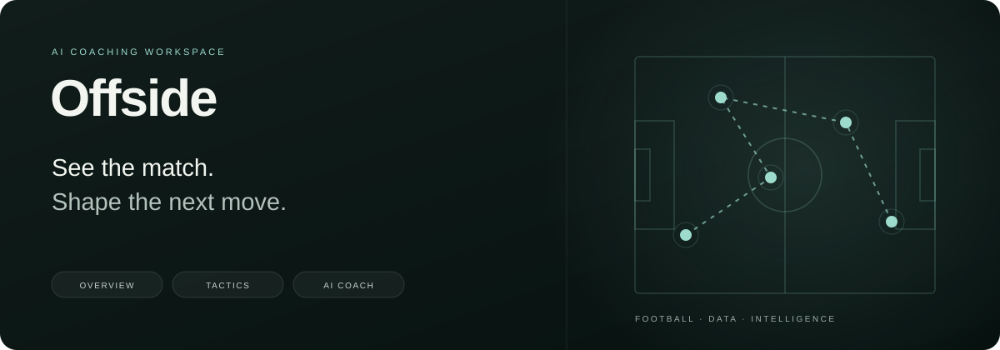
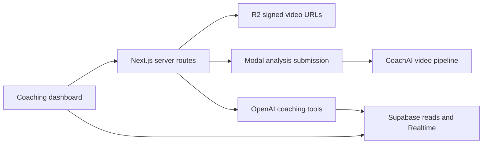

<p align="center">
  
</p>

<p align="center">
  <a href="https://github.com/KhalidD0nc/offside-frontend/actions/workflows/ci.yml"></a>
  
  
  
  
</p>

<p align="center"><strong>Match analysis, tactical planning, and an AI coaching assistant in one workspace.</strong></p>
<p align="center">
  <a href="#the-workspace">Features</a> ·
  <a href="#run-locally">Quick start</a> ·
  <a href="Docs/ARCHITECTURE.md">Architecture</a> ·
  <a href="CONTRIBUTING.md">Development workflow</a> ·
  <a href="https://github.com/KhalidD0nc/Video-Agent-Analysis-Service">Video analysis service ↗</a>
</p>

Offside is a football coaching dashboard built with Next.js, React, and TypeScript. It brings team performance, match footage, formation planning, opponent scouting, and a tool-using AI assistant into a shared interface.

The current implementation is scoped to **Al-Hilal Saudi FC** and reads from an existing Supabase football analytics dataset. Its companion [CoachAI service](https://github.com/KhalidD0nc/Video-Agent-Analysis-Service) handles video inference on Modal.

## The workspace

| Area | Route | Capabilities in the code |
| --- | --- | --- |
| Overview | `/overview` | Team KPIs, performance trends, goal timing, player statistics, and tactical insights |
| Analysis | `/analysis` | Match video library, analysis submission, and live job progress |
| Match detail | `/analysis/[matchId]` | Video playback, tactical phases, and match findings |
| Formations | `/formations` | Tactical pitch, lineup planning, substitutions, and opponent intelligence |
| AI Assistant | `/ai-assistant` | Coaching answers with evidence and citations from predefined data tools |

The UI uses Tailwind CSS, Recharts, Lucide icons, and Material Symbols. The repository banner illustrates the product's scope; it is not an application screenshot.

## How the pieces connect



Analysis results and progress must be written back to Supabase by the deployment's persistence/status bridge. That worker is not included here. See [architecture and integration boundaries](Docs/ARCHITECTURE.md).

## Run locally

### 1. Install dependencies

Use **Node.js 22 LTS** and npm. Next.js requires at least Node.js 20.9.

```bash
git clone https://github.com/KhalidD0nc/offside-frontend.git
cd offside-frontend
npm ci
cp .env.example .env.local
```

### 2. Configure services

Fill `.env.local` using [`.env.example`](.env.example). The required values depend on the area you want to use:

| Variables | Used for |
| --- | --- |
| `NEXT_PUBLIC_SUPABASE_URL`, `NEXT_PUBLIC_SUPABASE_ANON_KEY` | Dashboard reads and Realtime subscriptions |
| `SUPABASE_SERVICE_KEY` | Server-side analysis submission and job records |
| `R2_ACCOUNT_ID`, `R2_ACCESS_KEY_ID`, `R2_SECRET_ACCESS_KEY`, `R2_BUCKET_NAME` | Match video listing and signed playback/download URLs |
| `MODAL_SUBMIT_URL` | Asynchronous CoachAI submission |
| `OPENAI_API_KEY`, optional `OPENAI_MODEL` | Coaching assistant and opponent analysis |

Only the two `NEXT_PUBLIC_` values are intended for the browser. Keep service-role, storage, and AI keys server-side. Public Supabase access relies on your database's grants and row-level policies.

**Database prerequisite:** this is not a self-contained demo database. The UI expects populated football tables/views such as `ref_teams`, `team_performance_summary`, `matches`, and `tactical_phases`. The included [migration](supabase/migrations/20260427142257_async_analysis_status.sql) extends an existing `matches` table; it does not create the complete analytics schema. See [the architecture notes](Docs/ARCHITECTURE.md#data-prerequisites).

Set `MODAL_SUBMIT_URL` and `R2_BUCKET_NAME` explicitly for your environment: the application currently has project-specific fallback values. No provider credentials or live demo data are included.

### 3. Start the dashboard

```bash
npm run dev
```

Open [localhost:3000](http://localhost:3000); the root redirects to `/overview`. Use a configured database to load the dashboard's data-backed screens.

## Quality checks

```bash
npm run lint
npm run typecheck
npm run build
```

`typecheck` generates Next.js route types before running TypeScript. Build-time checks need valid-format public Supabase settings, but do not establish that a live backend is working. CI supplies local placeholder values, runs lint/type/build checks, and does not submit analysis jobs or call AI providers.

To run a built application with your configured environment:

```bash
npm run start
```

## Repository map

```text
src/
├── app/
│   ├── (app)/          # Overview, analysis, formations, and assistant pages
│   └── api/            # Analysis submission and AI route handlers
├── components/         # Dashboard, match, pitch, chat, and navigation UI
├── contexts/           # Active analysis job state
├── hooks/              # Match status subscriptions
└── lib/
    ├── ai/             # OpenAI clients, agents, and predefined tools
    ├── queries/        # Supabase queries by product area
    ├── r2/             # Server-side storage client
    └── supabase/       # Browser/read and service-role clients
supabase/migrations/    # Incremental database changes
Docs/                   # Architecture, product/design notes, and README assets
```

## Development and releases

```text
feature/* → development → staging → main
```

| Branch | Purpose |
| --- | --- |
| `development` | Integrate reviewed feature changes |
| `staging` | Prepare and validate a release candidate |
| `main` | Stable source reference |

CI runs for pushes and pull requests targeting these branches. Deployment is configured separately. A `staging` branch alone does not provision a preview site, database, or GPU environment; use distinct service settings when connecting deployments.

Read [CONTRIBUTING.md](CONTRIBUTING.md) before opening a change. The existing feature branches remain available.

## Project scope

The repository contains implemented dashboard and AI integration code. Team selection is currently fixed in several queries and route handlers, and the analysis submission handler still carries a TODO for user authentication. Set up authentication and deployment access controls before exposing write endpoints to users.

For the current implementation, start with [architecture](Docs/ARCHITECTURE.md). The older [product requirements](Docs/product_requirements_document.md), [design notes](Docs/DESIGN.md), and [API notes](Docs/API_DOCS.md) provide additional project context and may describe deployment-specific behavior.
